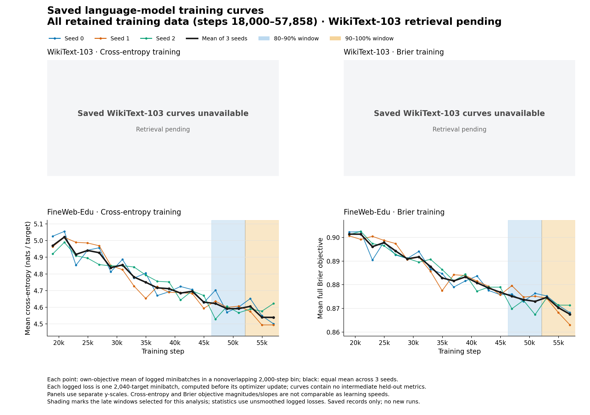
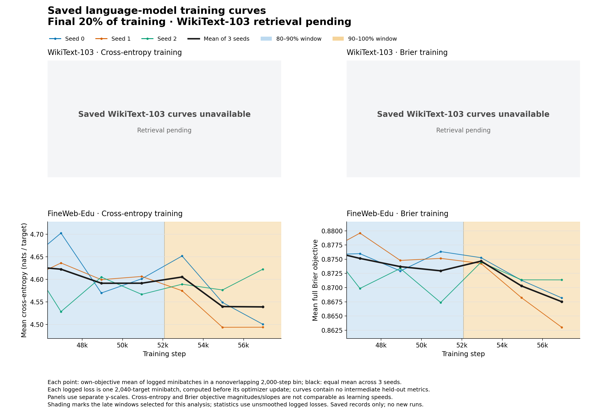

# Saved language-model training curves: WikiText access blocked

**Doc link:** <https://github.com/brando90/ultimate-utils/blob/main/experiments/06_brier_vs_ce_alexnet_dense_lm/curve_analysis/README.md>

**TLDR:** FineWeb-Edu's saved training losses show descriptive late improvement for both objectives, with noisy results that depend on the time window. WikiText-103 curves remain unavailable locally because the gateway resets the connection before authentication; the requested two-corpus comparison is incomplete.

Analysis date: 11-09-2026. Canonical study: `experiments/06_brier_vs_ce_alexnet_dense_lm`. This is post-processing of finished runs, with no new training, model evaluation, or remote writes. All original trainer outputs are preserved.

Google companion: [Assistant Results](https://docs.google.com/document/d/1xkEn8vW800jBucuJANuXD8ph-sMQMofwNZw_nJzjJls/edit?tab=t.ty5se4uscfip).

## What can be concluded now

The completed endpoint comparison favors cross-entropy training on both language-model datasets at the tested budget: 123,551,232 parameters and 118,032,360 prediction targets over 57,859 steps, with three paired seeds. Cross-entropy training has higher held-out accuracy and lower held-out cross-entropy, perplexity, and full Brier score. This is a finding about measured endpoints, not converged solutions. See the [five-part synthesis](../SUMMARY_RESULTS_11-08-2026.md) and its uncertainty tables.

FineWeb-Edu's late training loss continues to decrease descriptively for both objectives. Each objective improves in two of three seeds when comparing the final 10% of training with the preceding 10%; both improve in all three seeds in the adjacent final 5% and final 20% sensitivity comparisons. Fitted slopes over the final 10% are also negative for every seed. These are exploratory observations, not a convergence test or a reliable prediction of future gains.

The records cannot determine whether Brier would eventually catch up in held-out accuracy. Every logged point measures a different minibatch, and no intermediate held-out accuracy or common-loss trajectory was saved in these state records. Cross-entropy and Brier objectives also have different scales, so comparing their raw magnitudes, slopes, or relative percentage changes does not measure which learns faster. Both runs use a decreasing learning rate; flattening under that schedule would not establish a stationary or globally optimal solution.

## Figures

Both figures explicitly mark WikiText-103 as unavailable. No WikiText trajectory is reconstructed from its endpoint table.





The colored traces show each seed and the black trace is their equally weighted mean. Displayed points average logged losses in nonoverlapping 2,000-step bins anchored at step zero; the final bin is shorter. The shaded windows are 80–90% and 90–100% of the planned steps. Statistics below use unsmoothed observations. Panels use separate vertical scales. Vector figures: [overview](saved_training_curves.svg), [late close-up](saved_training_curves_late_zoom.svg).

## Primary exploratory contrast

The contrast is **later-window mean minus earlier-window mean** of each run's own training objective; negative means the average logged loss fell. The windows are steps 46,300–52,000 (58 observations) and 52,100–57,858 (59 observations), selected by the intervals [0.8, 0.9) and [0.9, 1.0) of 57,859 planned steps. Cross-entropy uses natural-log units per prediction target; full Brier is the sum of squared probability errors over all classes, without division by class count.

| Corpus and training objective | Earlier mean | Later mean | Change [95% seed-bootstrap interval] | Exact two-sided sign-flip p-value | Seeds with lower later loss |
| --- | ---: | ---: | --- | ---: | ---: |
| WikiText-103, cross-entropy | unavailable | unavailable | retrieval pending | unavailable | unavailable |
| WikiText-103, Brier | unavailable | unavailable | retrieval pending | unavailable | unavailable |
| FineWeb-Edu, cross-entropy | 4.595507 | 4.558970 | −0.0365373 [−0.0881212, +0.0380242] | 0.50 | 2/3 |
| FineWeb-Edu, Brier | 0.873500 | 0.870803 | −0.00269688 [−0.00747935, +0.00320718] | 0.50 | 2/3 |

The FineWeb-Edu seed-wise changes are −0.05951485, −0.08812120, and +0.03802420 for cross-entropy; −0.00381846, −0.00747935, and +0.00320718 for Brier. This window does not provide clear seed-level evidence of a nonzero change, and the failure to reject zero does not establish a plateau.

## Window sensitivity

These contrasts were selected after inspecting FineWeb-Edu's initial late-window analysis and before retrieving WikiText-103. They are exploratory, not preregistered tests; every selected window is reported.

| FineWeb-Edu objective | Compared fractions of training | Change [95% seed-bootstrap interval] | Exact two-sided sign-flip p-value | Seeds with lower later loss |
| --- | --- | --- | ---: | ---: |
| Cross-entropy | 95–100% minus 90–95% | −0.0344616 [−0.0550429, −0.0142898] | 0.25 | 3/3 |
| Brier | 95–100% minus 90–95% | −0.00511155 [−0.00819237, −0.00223615] | 0.25 | 3/3 |
| Cross-entropy | 80–100% minus 60–80% | −0.115754 [−0.132959, −0.100308] | 0.25 | 3/3 |
| Brier | 80–100% minus 60–80% | −0.00823776 [−0.00994282, −0.00646296] | 0.25 | 3/3 |

Ordinary least-squares slopes over the final 10%, in own-objective units per 1,000 steps, are −0.028129, −0.012695, and −0.001686 for cross-entropy, and −0.001494, −0.002475, and −0.001363 for Brier. These slopes are descriptive; no p-values treating logged minibatches as independent replicates are calculated. Over the final 20%, one seed for each objective instead has a positive fitted slope, reinforcing the window sensitivity. All per-seed window means, standard deviations, slopes, and plotting bins are in [saved_curve_statistics.json](saved_curve_statistics.json).

## Measurement and statistical limits

- FineWeb-Edu retains 400 points per final validation record, steps 18,000–57,858. There are six records: two objectives by three seeds. The first approximately 31% of each final training trajectory is absent from this state file. Test records have empty curves.
- A `train_loss` is the selected objective averaged over one minibatch of eight sequences and 255 targets per sequence, or 2,040 targets. It is computed before the optimizer update and appended after that update, every 100 steps plus the final step. It is neither an interval average nor an evaluation on a fixed dataset.
- Validation and test evaluation occur only at the end of each run. The 3,921-step tuning endpoints come from separate runs with shorter schedules and must not be inserted as intermediate points on a final-run trajectory.
- Both objectives selected peak learning rate 0.0003. The final schedule uses 500 warmup steps and cosine decay toward 0.00003. Equal nominal rates do not establish equal effective optimization dynamics.
- The replication unit is the training seed, n=3. Each 95% interval enumerates all 27 ordered three-seed bootstrap resamples and uses inverse empirical cumulative-distribution quantiles. The exact two-sided sign-flip test assumes seed-level changes are symmetric about zero under the null, with exchangeable signs; all eight sign assignments are enumerated. P-values are unadjusted for multiple exploratory comparisons. Their minimum is 0.25, even if all three changes have the same sign.
- These coarse bootstrap intervals are conditional summaries of observed seed variability, not reliable population-coverage guarantees. They do not include uncertainty from datasets, model architecture, tuning, or analysis-window selection. The bootstrap interval is not an inversion of the sign-flip test.
- The implemented training loss is full multiclass Brier, `sum_k (q_k - 1{k=y})^2`. The true-class-only squared loss `(1-q_y)^2` is a separate diagnostic in `losses.py`; it was not the Brier training objective. The pasted discussion about weighted divergence therefore does not redefine this study's loss.

Sources: [training loop and logging](../train_lm_fixed.py), [FineWeb driver](../train_fineweb.py), [loss definitions](../losses.py), and [FineWeb saved state](../fineweb_edu/state.json). Input and source-code hashes are recorded in the numerical JSON. FineWeb state SHA-256: `eec2e1453221c15e9d3442753b9e7328a8b110bbd4e9e24b0ad759a8c133891a`.

## Retrieval status and reproduction

WikiText-103's expected source is `/lfs/mercury2/0/brando9/brier_ce_pilot_076e/lm_fixed/state.json`. It was not found in either local checkout, the matching Git history, eight Cursor transcript files, 58 Codex session files dated 11-06-2026 through 11-08-2026 (excluding this chat and its children as independent evidence), or the emailed consolidated results archive. The old ignored top-level `summary.json` contains early image-model tuning output, not the finished WikiText curves.

At 12:12 PST on 11-09-2026, an existing guarded read through `whale.stanford.edu` failed with “Connection reset by peer” before authentication. The guard retained its failure backoff, with next eligibility at 13:12:16 PST. No reusable gateway or target socket was found, Cisco VPN was disconnected, and the checked Codex inventory exposed only this local host. An existing authenticated Sherlock runner could execute ordinary reads, but it had no socket under the user's SSH directory, no home keytab or SSH configuration, no Kerberos tools on its current PATH, and no readable copy at the exact WikiText source path. No credentials were transferred and no new authentication challenge was initiated.

The connection failure is established; a target-node outage or missing remote file is not. The requested WikiText comparison remains incomplete. There is currently no task-owned retrieval running or scheduled. [Retrieval status](retrieval_status.json) records the sanitized evidence and source hashes; the [checkpoint](../CKPT_brier_ce_pilot.md) records the recovery history. The prepared retriever handles transient guard contention and can preserve complete private diagnostics; nine mocked regression checks passed without network access. A future retrieval must use an established authorized connection or the shared guard's then-current permitted window.

From the designated study worktree:

```bash
# Post-process only the available saved input; WikiText remains visibly unavailable.
arch -x86_64 /usr/local/bin/python3 experiments/06_brier_vs_ce_alexnet_dense_lm/curve_analysis/analyze_curves.py --available-only
python3 experiments/06_brier_vs_ce_alexnet_dense_lm/curve_analysis/analyze_curves.py --check --available-only
# Once WikiText state is present, omit --available-only to require both corpora.
```

The Intel interpreter uses the already installed Matplotlib and NumPy on this Mac. Numerical checking uses only the Python standard library. The separate retrieval script performs one guarded, bounded read; it has no model-training or evaluation path. Do not launch a competing retrieval while another guarded request is waiting.

**Copy-ready message:** Cross-entropy has better measured language-model endpoints at our fixed budget, but we have not established a worse converged solution for Brier. FineWeb's saved own-loss curves still improve descriptively near the end for both objectives; WikiText's curve comparison is pending retrieval, and neither dataset has intermediate held-out trajectories in the saved state design.

**TLDR-end:** [ultimate-utils: saved training curves] FineWeb-Edu shows descriptive late improvement with substantial window sensitivity. The WikiText-103 comparison is pending, and the available curves do not distinguish eventual catch-up from a persistent gap.
